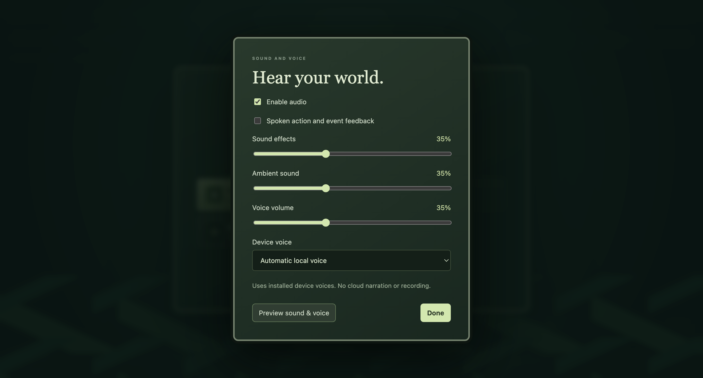

# Sound and spoken feedback, 0.25.0

Open **Audio** in the running game, or **Sound & voice** on the main menu. Enable
audio and use Preview. Effects, ambience and voice have separate volume controls;
spoken feedback also has its own checkbox and installed-device-voice selector.
Audio starts disabled on a fresh profile. Preferences persist on this device,
separately from saved worlds, and take effect after a user interaction.

## Action feedback

| Action | Sound family | Spoken feedback |
| --- | --- | --- |
| Menus, tools, layers and settings | Short UI/selection tones | Selected control or option |
| Terrain, water and plants | Earth, water or planting effect | Applied tool, after the stroke settles |
| People and wildlife | Placement effect | Placement result or selected creature |
| Fire, lightning, meteor and explosion | Distinct noise and pitch envelopes | Applied power or rejection message |
| Rain, storm, blizzard, drought and tsunami | Rain, thunder, wind or wave effect | Tool result; existing placement rules still apply |
| Zoom, Fit and camera movement | Quiet camera cues | Settled zoom percentage, whole-world view or movement |
| Pause and speed | Down/up tones | Actual paused/running state and selected speed |
| Inspect citizens, wildlife and armies | Inspection cue | Selected creature or army count |
| Save, load and failures | Confirmation or alert cue | Actual completion or failure, rather than a success before writing |
| New major world events | Coronation, war, peace, research, construction or disaster cue | The new event text |

The synthesized effects are original. There are no downloaded sound clips, cloned
voices or extracted WorldBox assets. Spoken feedback uses voices already installed
on the device and filters out remote voice providers. If no local voice is exposed
by the browser, the settings explain that effects still work. Voice errors also
leave effects available. Voice selection can vary between macOS and Windows.

## Keeping it quiet and current

At most six effects play simultaneously. Repeated actions have cooldowns; brush
and camera narration waits briefly for input to settle. Speech retains one current
utterance and only the latest pending announcement, replacing stale pending work.
Major world events are limited to one cue per five seconds. Routine simulation
ticks and each individual citizen's movements are not narrated.

Voice volume changes apply to subsequent announcements; setting it to zero also
stops the current announcement.

Master mute cancels speech and fades effects and ambience to silence. Disabling
narration or setting its volume to zero cancels speech independently. Hidden pages
silence audio and cancel pending speech; returning does not replay it. Loading a
world resets the event cursor, so old history is not read out as new events.

Audio reads presentation actions and new history entries. It does not advance
time, change the random generator, alter entities or write world-save data. These
settings are device preferences, not additions to the world format.

## Verification

Policy tests cover safe settings, rate and concurrency limits, local-only speech,
latest-only pending announcements, mute/background cancellation, provider failure
and avoiding historical replay. Desktop tests render every effect with real Web
Audio, check distinct/non-silent/unclipped PCM, verify real local-speech start and
completion where voices exist, exercise volume/mute controls and compare exact
paused world snapshots. Layout is checked at 1024×768 and 1366×768.
