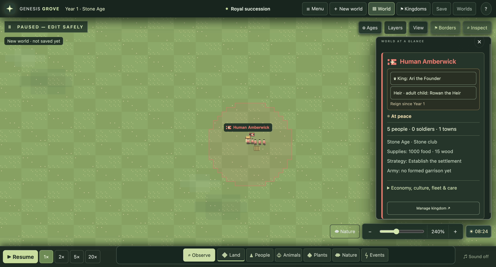
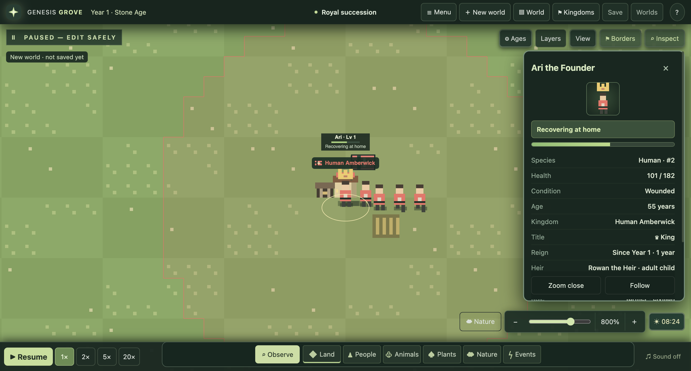

# Kings and succession

Each kingdom has one King, drawn from its own citizens. The King keeps the same
name, family, age, health, equipment and relationships. The crown does not prevent
aging, injury, starvation or death.

## Find the royal household

Open World, select a kingdom, and use the two compact royal buttons:

- **King** opens that citizen's portrait, title, reign, heir and royal policy.
- **Heir** opens the next eligible citizen. Both profiles support Zoom and Follow.

The existing gold crown identifies the King on the map. No additional permanent
name cards or royal banners are added. Full economy and culture effects remain
inside the kingdom's expandable details.

## Succession rules

A living adult King retains the crown, including while travelling. When the King
dies, is captured, or leaves the kingdom, the next normal simulation cleanup
chooses a successor from living, free, non-travelling residents aged 18 or older:

1. Eligible direct children of the outgoing King have priority, oldest first.
2. Without an eligible direct child, experience and age determine the successor.
3. ID breaks exact ties, so reading the heir never consumes randomness.

Grandchildren and other relatives use the merit rule in this first slice. A
minor child cannot inherit ahead of an eligible adult. If no adult can succeed,
the crown stays vacant until one becomes eligible; this slice has no regency.
The heir display is a preview of current eligibility, not a permanent assignment.
The event history records each subsequent coronation and whether it used direct
inheritance or merit. Founding settlers receive the first crown.

## Policy and records

The King's existing personality has real effects: Scholar adds 15% research,
Builder adds 12% production, Guardian adds 15% training, Diplomat favors alliances,
and Conqueror is more willing to wage war. Culture can contribute further bonuses;
the kingdom's expanded details show combined effects.

Newly founded and subsequent reigns record their starting world year. Older saves
keep their existing King and show that the reign began before royal records.
Loading or inspecting a paused world does not select a different King, advance
time, change family links or alter citizens. Old save calendars remain supported.

This slice does not add palaces, bodyguards, royal armies, regents or dynastic
claims beyond direct children. These can be separate later steps.
