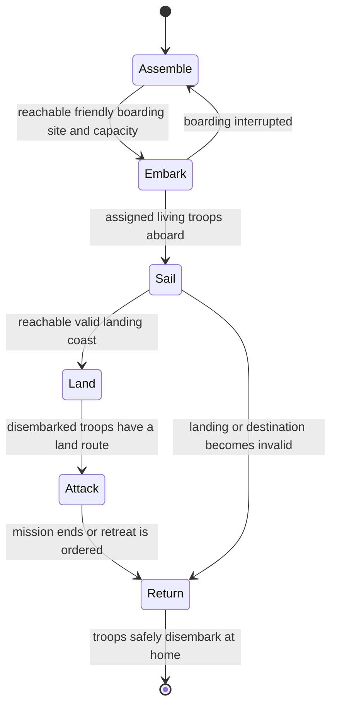

# Gameplay priorities

## Current planning path, 22 October 2026

The [sandbox mechanics and UI plan](video-analysis/README.md) updates the order
below for the current workstream: map-first UI, named saves and automatic
recovery, explainable land warfare, naval invasions, long-run observation, then
larger maps. See the [visual roadmap](video-analysis/roadmap.svg) and
[UI requirements](video-analysis/ui-plan.md). The sections below distinguish completed slices from planned work. Further hazards and deeper character systems remain later options.

## Completed first slice, 0.18.0

The first M0 slice now provides Observe default, a compact dock, contextual tools,
concise inspectors and native input checks. A Nature slice adds moving rain and
storms, lightning, drought, blizzards and deep-ocean coastal tsunamis, with optional
automatic events and saved state. Version 0.19.0 adds named saves/recovery, map
layers and presentation view. Version 0.20.0 adds compact army inspection and
focus/follow. Version 0.21.0 persists autonomous orders, explains their reasons and
uses actual health, food, strength and land reachability. Version 0.22.0 fixes local fire bounds, tsunami frequency and rebellion household/home
consistency after investigating a real population collapse. [Evidence and remaining
balance work](survival-and-disasters.md). Version 0.23.0 repairs distant-family birth blocking and reduces dense-city map
clutter. [Investigation and limits](generations-and-map-readability.md).
Version 0.24.0 exposes kings and heirs, records new reigns and prioritizes eligible adult direct children during succession. [Rules and UI](kings-and-succession.md).
Version 0.25.0 adds smooth anchored zoom, touch gesture protection and progressive
map detail, plus action sounds and local spoken feedback. [Audio coverage](audio-feedback.md). [Camera controls and visibility levels](zoom-and-visibility.md).
Version 0.25.1 validates two populated save snapshots over long runs and fixes event
sound classification. [Stability results and limits](stability-pass-0.25.1.md).
Version 0.26.0 adds visible attacker-owned town sieges and capital surrender, with
asset-preserving transfers and obsolete-war cleanup. [Rules and inspector](town-sieges.md).
Version 0.27.0 adds individual traits, strict diets and survival decisions
([simulation phases](simulation-roadmap.md)), followed by the first compact,
read-only [Ship Inspector](ship-inspector.md).
The four kingdoms are only the video example; no dedicated setup is planned.
Next: scoped military transport, followed by deeper character inheritance
and ecosystem/economy balance. Ship inspection is the prerequisite observation
milestone; it introduces no new combat or troop transport.
See [nature mechanics](nature.md) for current effects and later hazards.

## Earlier feature priorities

The current release implements the first three priorities: supply-aware kingdom
strategy, obstacle-aware land routes, and individual names, traits, experience,
and parent records. Close inspection, working industries, and stable day/night
lighting support those systems. Version 0.12 adds fourteen ages through Cosmic Dust, visible ranged weapons, roads and local transport, monuments, varied tree artwork, angels and demons, and persistent kingdom flags with ruler succession.

Continue in this order:

4. Naval transport: build on the read-only Ship Inspector in the stages below.
   Existing aircraft carry food; army transport and new ship combat remain future work.
5. Further environmental events: inland floods and volcanic activity. Droughts,
   blizzards and bounded coastal tsunami flooding shipped in 0.18.0.
6. Richer maps: rivers, lakes, coherent mountain ranges, and larger maps with
   performance limits and clearer biome transitions.
7. Save recovery: delivered in 0.19.0; extend as larger maps and longer histories require.

Later character work can add relationships, family trees, and inherited traits.
Current parent records and personality traits are intentionally simpler.

Cosmic follow-up: orbital maps, star-system travel, off-world colonies, and distinct alien civilizations. Current stargates and hover transports support towns on the existing map.

Version 0.28.0 addresses the [native play-review findings](play-review-fixes.md)
before military transport: real water return routes, inspector clarity, child
routines and individual garrison recovery.

## Naval milestones

### N1 — Ship Inspector

Read-only observation of existing `voyages` and `trades` whose kind is `ship`,
and `machines` whose kind is `boat`. Match their actual rendered positions,
ownership and modeled state. Use the same contextual card, Focus and Follow as
army inspection; keep unavailable crew, passenger, cargo and health data explicit.
Selection and camera movement must preserve paused simulation state. No save
schema changes, new vessels, fleet orders or combat are introduced in this slice.
See [the ship inspection runbook](ship-inspector.md).

### N2 — military transport (planned)

The next transport state machine is:

- **Assemble:** bind an existing garrison and target; check food, capacity,
  reachable friendly embarkation and an accessible target coast. Explain blocked
  plans without creating troops or starting an impossible voyage.
- **Embark:** reserve seats, move actual eligible soldiers to the boarding site,
  and transfer each identity exactly once. Separate troop passengers from crew;
  aboard troops do not gather, walk, fight on land or count toward a siege.
- **Sail:** move through valid connected water using bounded routes. Track finite
  compatible provisions, capacity, occupants, destination and activity in the Ship
  Inspector. Keep all transitions on simulation time with seeded decisions.
- **Land:** recheck the coast and ownership before releasing troops onto safe
  walkable tiles. Blocked coasts wait, seek a bounded alternative or return;
  troops cannot teleport inland or be duplicated by repeated landing steps.
- **Attack/return:** hand landed soldiers back to existing land orders. A retreat,
  ended war, changed target or failed mission chooses a reachable return coast
  and safely unloads at home. Define interrupted embarkation, lost crew and missing
  vessel recovery before enabling the feature.

Persist transport order, stage, route progress, assigned identities and provision
stocks, with old worlds receiving no active transport orders. Preserve world
limits and validate references before accepting an import. Acceptance scenarios:
full/partial capacity, unreachable coasts, crew/passenger separation, exact food
and identity conservation, interruption at each stage, missing vessels, changed
ownership, pause/speed, deterministic mid-stage save/resume and compact native UI.
This milestone does not require implementing ship combat; combat is separately
scoped after transport can complete and return reliably.
