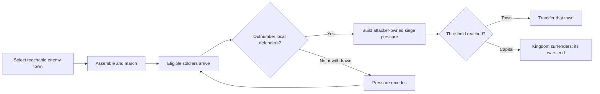

# Town sieges and capital surrender

The siege display explains the actual town-level pressure, not a prediction of an
individual soldier's damage or an army's guaranteed victory. The named target,
attackers, defenders and progress appear in Army Inspector. A Target button takes
the camera to the town; active siege badges stay small and use screen pixels.

## Campaign path

## Rules

- Towns require 24 pressure; capitals require 48. Progress uses simulation time,
  with a maximum of two pressure per second, so a large army cannot capture instantly.
- At least two eligible soldiers must be near the site, with a local land route,
  and outnumber its defenders. Nearby castle defenses count separately.
- Traveling crews, prisoners, dead soldiers, recovering people and working machine
  crews do not supply siege pressure. A nearby soldier across water does not count.
- Progress belongs to one attacking kingdom. A rival cannot inherit it. Withdrawal
  reduces pressure; peace ends the siege. Inspection while paused changes no state.
- A captured town changes ownership coherently. Capital surrender transfers the
  defeated kingdom's towns and population, preserving citizen identities and homes,
  along with stocks, facilities and transport. Obsolete wars and army orders end.
  Town voyage passengers and machine crews keep their former kingdom and are rehomed
  to its capital; a later capital surrender transfers those assignments together.
- Existing saves remain readable. Siege attacker identity is saved separately from
  the pressure value; old saves do not invent an attacker for unattributed pressure.

## Display

World overview keeps civilization markers. During a siege, a restrained badge
shows town progress. Army Inspector shows the selected campaign's target, the
actual faction supplying siege pressure, local defenders and the capture rule.
A town pressured by a different kingdom is identified explicitly. Equipment stays
in the existing disclosure panel, preserving the compact inspector layout.

## Preservation and limits

Normal town creation keeps its 240-colony cap. Former capitals have bounded
reserved conversion slots, so reaching the normal cap does not make a capital
immune to surrender. The historic defeated kingdom remains available as a dead
record; its people survive under the new owner. Aggregate storage bounds account
for combined kingdoms rather than truncating captured resources or buildings.

Capital surrender currently annexes the defeated kingdom; it does not create
vassals, negotiate reparations, move capitals or provide a diplomatic bargaining
screen. Naval troop transport is a later feature.

## Validation

187 Node tests and syntax lint passed. New checks cover real marching, local route
blocking, capped duration, rival pressure, peace and withdrawal, crew/prisoner/home
eligibility, mid-siege deterministic save/resume, capital asset and cargo transfer,
capacity limits, and adding citizens after the historical kingdom limit.
Native desktop fixtures cover town and capital progress, named pressure owner,
castle defense, Target focus, 1024/1366 layouts, presentation mode, stale-target
removal and exact paused-state preservation. Test windows run hidden to isolate
feature checks from physical mouse/trackpad input.
