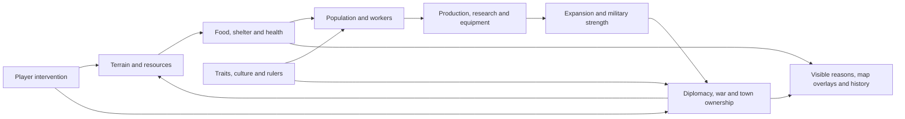

# Four kingdoms: mechanics and UI plan

Planning document · 21 October 2026 · baseline: Genesis Grove 0.17.0, commit `a86e98a`.

The goal is a living world that is enjoyable to watch and easy to understand.
Give the map most of the screen, reveal detail when requested, and make the
simulation's decisions visible. Improve this experience before adding more ages,
species, or decorative panels.

## Read this first

- [Visual roadmap](roadmap.svg): implementation order and completion gates.
- [UI layout concept](ui-layout.svg): Observe, Create and Inspect; not an implemented screen.
- [UI requirements](ui-plan.md): navigation, inspectors, overlays, and interaction rules.
- [Video evidence](evidence.md): timestamped observations and limits of this review.

PNG copies: [roadmap](roadmap.png) and [UI layouts](ui-layout.png).

Reference: the supplied local file, **Simulating 4 Kingdoms Fighting Over A MASSIVE
World (That I Made!).mp4**, duration **33:52.64**, resolution **854 × 480**.
The full runtime was reviewed chronologically using 1,016 visual samples at
two-second intervals, plus close examination of selected frames and the endpoints.
This is a frame-sequence review, not continuous playback at 2×. Very short actions
can fall between samples. Audio and narration are excluded at the user's request.
The observed screens support the design lessons below; they do not reveal the
reference game's hidden algorithms or prove what caused every event.

## What the video teaches us

| Observation | What we should carry into our game |
| --- | --- |
| The map dominates normal play; tools sit in compact groups near an edge. | Default to an uncluttered Observe view. Open creator controls only when editing. |
| Kingdom banners, colors, borders, and compact summaries remain recognizable at different zooms. | Keep kingdom identity consistent across map, armies, inspectors, diplomacy, and history. |
| Citizen, kingdom, culture, equipment, and trait details appear in contextual windows and tooltips. | Show a short summary first; offer tabs and explanations for deeper information. |
| Settlements visibly grow into roads, farms, docks, and denser housing. | Make economic progress legible on the map and explain shortages through inspection. |
| Traits show explicit benefits and penalties; equipment has its own details. | Explain the modifiers we actually simulate. Add richer traits only with corresponding behavior. |
| Waterways, mountain regions, peninsulas, and narrow connections separate settlements. | Treat geography as a constraint on expansion, supply, and military access. |
| The late video combines ships, fighting, changing territory, and diplomatic overlays. | Connect land warfare, sea transport, and diplomacy; expose routes and ownership changes. |
| The creator repeatedly switches between a whole-world view and individual people. | Preserve orientation, selection, and a quick return to the wider world. |

The random wheels shown during initial trait selection are an external presentation
tool. A built-in seeded randomizer is our optional adaptation, not an observed
WorldBox feature. Editing zooms, black borders, captions, and time skips are video
presentation, not UI requirements.

## The simulation we need to make understandable

This is a proposed model for Genesis Grove. Much of this loop already exists in
our source. The next work should connect it, expose its causes, and fill the gaps.
The player should be able to create conditions and observe autonomous outcomes
without issuing routine orders to every citizen.

## What already exists and what needs work

Source inspection confirms these capabilities; no fresh gameplay test was run for
this documentation update. The inspected local simulation, app, and renderer files
match the public baseline commit.

| Area | Current implementation | Required addition or improvement | Priority |
| --- | --- | --- | --- |
| Main UI | Large header, collapsible creator sidebar, two-row tool catalog, information drawer. | Map-first Observe default; compact dock; contextual editing controls. | P0 |
| Inspection | Citizen portrait, traits, health risks, family, equipment, Follow; kingdom details in diplomacy dialog. | Unified non-modal inspector with short summaries, tabs, clickable identities, and clear selection. | P0 |
| Map readability | Territory tint, flags, labels, minimap, zoom and pan. | Zoom-based label density, named overlay modes, army/route/siege explanations. | P0 |
| Scenario setup | Sandbox, 100 kingdoms; four-continent landscape; usual sandbox tries to seed three kingdoms. | Dedicated four-kingdom scenario with editable starts, seed, rules, and validated spawn sites. | P1 |
| World building | Seeded biomes, terrain brushes, finite ores; fixed 192 × 128 map. | Original scenario geography with lakes, channels, mountain passes, and viable starts; larger dimensions later. | P1/P3 |
| Economy | Jobs, finite resources, farms, reserves, housing, medicine, research, visible daily routines. | Surface bottlenecks and explain labor, food, equipment, and recruitment decisions. | P1 |
| Traits and culture | Five base personality traits, inherited aptitudes, bounded relationships, four fixed traditions, ruler effects. | Inspectable modifier breakdown; configurable trait sets later. | P1/P3 |
| Land war | Soldiers grouped by home town, nearest enemy town on the same landmass, retreats and sieges. | Persistent army orders, defense priorities, supply limits, visible siege status, gradual conquest. | P1 |
| Diplomacy | Pairwise peace/alliance/war; autonomous choices among nearby capitals. | Reachable cross-sea rivals, explicit decision reasons, bounded treaty timers; coalition behavior later. | P1/P2 |
| Ships | Settler/trade voyages and separately crewed fishing/coastal combat boats. | Routed army transports with real passengers, embarkation, landing and interrupted-mission rules. | P2 |
| War history | Latest 200 events with locations; Visit shows the current map. | Grouped war records, important milestones, casualty/capture summaries and optional saved map snapshots. | P2 |
| Save recovery | One manual device slot and JSON import/export; no autosave. | Autosave ring and named slots before encouraging long unattended simulations. | P1 |
| Culture/religion depth | Fixed culture bonuses and civic sanctuaries; no evolving language/religion simulation. | Later optional systems with actual effects; keep separate from kingdom ownership. | P3 |

## Implementation path

Effort bands describe relative scope, not dates: **S** is a localized change,
**M** crosses a few modules, **L** changes simulation state or navigation broadly.
The order below supersedes the older numbered priorities for this workstream.

### M0 — Make the world the main screen · P0 · M

- Establish Observe, Create, and Inspect interaction states; open in Observe.
- Replace permanent creator panels with a compact dock and optional tool popover.
- Keep pause/speed, current year, menu, selection, and zoom easy to reach.
- Build short citizen and kingdom summaries with optional detail tabs.
- Preserve existing simulation behavior and saved worlds during the UI pass.

**Done when:** at 1366 × 768, the unobstructed canvas occupies at least 80% of the
window in idle Observe mode. A new player can pause, paint land, place a people,
inspect a citizen, and return to Observe without instruction from the developer.
Escape and clicking controls never apply a map brush. See the UI acceptance list.

### M1 — Deliver a repeatable four-kingdom sandbox · P1 · M

- Add a Four Kingdoms scenario independently of the Four Continents landscape.
- Use an original map at the existing size first. Offer balanced and asymmetric
  starting conditions, four banners, chosen peoples, seed, and law toggles.
- Validate usable land, local food/wood/ore access and distances; show unmet
  requirements rather than silently starting fewer than four kingdoms.
- Preview actual spawn positions and geographic access. Default to a paused start.
- Add named world slots, bounded autosave recovery, and a pre-replacement snapshot.
- Explain town economy and current strategy through the inspector.

**Done when:** the same seed/settings produce the same starting state; four viable
kingdoms are visible; preview matches play; restoring a snapshot preserves state;
an invalid import cannot replace the active world. Balanced starts mean comparable
opportunity, not a guaranteed draw or survival time.

### M2 — Make land wars explainable · P1 · L

- Give armies stable identities and states: assemble, defend, march, attack, retreat.
- Evaluate reachable targets, threat, food and equipment instead of only distance.
- Show targets, supply condition, siege progress, and a short reason for each order.
- Record diplomatic intent and treaty timers. Keep current pairwise relations first.
- Make town capture local. The current capital-capture function transfers all towns
  and people immediately; introduce relocation or explicit surrender conditions.
- Keep civilians working and towns recovering while armies campaign.

**Done when:** an army cannot cross impassable terrain or attack an unreachable
target; a stronghold and supply shortage change an outcome; capturing a capital
does not silently transfer every remote town; the inspector explains the result.

### M3 — Connect the kingdoms across water · P2 · L

- Add water navigation and coast/dock reachability; reuse bounded routing concepts.
- Add a military mission with soldier IDs, capacity, crew, cargo, source and landing.
- Implement assemble → embark → sail → land → attack/return, preserving identities.
- Define loss, stranded passengers, destroyed docks, changed terrain and peace
  during transit; cancel or reroute missions with an explanation.
- Extend diplomacy target selection beyond the current nearby-capital radius when
  a sea route exists. Add ship combat only after transport works correctly.

**Done when:** a seeded two-island war can move the same named soldiers across
water and capture a coastal town. Save/load mid-voyage neither duplicates nor
loses passengers. A blocked coast, crew loss or peace has a defined visible outcome.
Ship icons in the reference are evidence for maritime activity, not proof of a
particular boarding algorithm; these mission rules are our design.

### M4 — Make a long simulation worth following · P2 · M

- Provide war summaries, important ruler/founding/capture events, and year markers.
- Separate current event locations from any actual historical map snapshots.
- Add kingdom pinning, army/ship following, and optional noteworthy-event focus.
- Default to quiet event badges; avoid repeated popups and forced camera movement.
- Retain compact battle visuals and offer a presentation mode that hides the dock.

**Done when:** a player can explain a kingdom's rise or fall from the UI and
history, follow a ship to its landing, and return to the previous map view. Old
history without snapshots is never presented as a playable past state.

### M5 — Scale geography after the loop works · P3 · L

- Move world dimensions into validated saved-world metadata and migrate old saves.
- Audit terrain arrays, indexing, generation, renderer caches, minimap, imports,
  coordinate checks, path budgets, AI queries and population limits together.
- Add chunked terrain/territory caching, spatial queries and distant-detail culling.
- Benchmark proposed larger sizes before exposing them in setup.

**Done when:** the chosen larger-map preset meets a documented performance budget
on named Mac and Windows hardware, preserves old saves, and keeps controls responsive
at 1× and 20×. Proposed target: p95 rendered frames ≤33 ms and pause input ≤100 ms;
measure simulation-step cost separately. No larger-map performance is claimed yet.

### Later options — Add depth selectively · P3

Configurable inherited traits; deeper family trees; evolving culture/religion;
multi-kingdom alliances; environmental events; equipment provenance and wear.
The reference shows interfaces for several of these. Select one at a time after
M0–M4, with a visible effect and a bounded saved-state design. Further cosmic ages,
off-world travel and extra species do not address this video's main UI lesson.

## Engineering handoff and release gates

| Work | Main code touchpoints | Required proof before completion |
| --- | --- | --- |
| M0 UI | `index.html`, `src/app.js`, `src/layout.css`, `src/ui.css`, `src/renderer.js` | Native pointer/keyboard smoke checks, screenshots at 1366×768 and 1024×768; no brush action through controls. |
| M1 setup/recovery | `World` constructor/generation/serialization in `src/simulation.js`, setup/save UI in `src/app.js` | Deterministic starts, spawn rejection, save migration and recovery/import failure cases. |
| M2 war | `src/strategy.js`, `plan_armies`, `resolve_sieges`, `conquer_site`, `src/defenses.js` | Reachability, retreat/supply effects, partial conquest, treaty transitions, save/resume. |
| M3 sea travel | `src/pathfinding.js`, voyages in `src/simulation.js`, `src/machines.js`, `src/crews.js`, renderer | Passenger conservation, water-only routes, invalid landing, crew/dock loss, peace and mid-trip restore. |
| M4 story | `World.log`, serialization, history/follow UI and renderer | Bounded history, preserved key events, valid links, camera return; snapshot claims match stored data. |
| M5 scale | Dimensions throughout simulation, renderer, pathfinding and import validation | Legacy saves, malformed size rejection, benchmark traces and both-platform interaction checks. |

Use small changes within each milestone. Run relevant deterministic simulation
checks plus real desktop UI checks for behavior changes. Publish completed source
updates according to project instructions. Make Mac/Windows packages only for an
actual desktop release, and distinguish a successful build from Windows playtesting.

**Scope of this update:** documentation and original diagrams only. It does not
implement the proposed UI or simulation, change saves, or create a new release.
