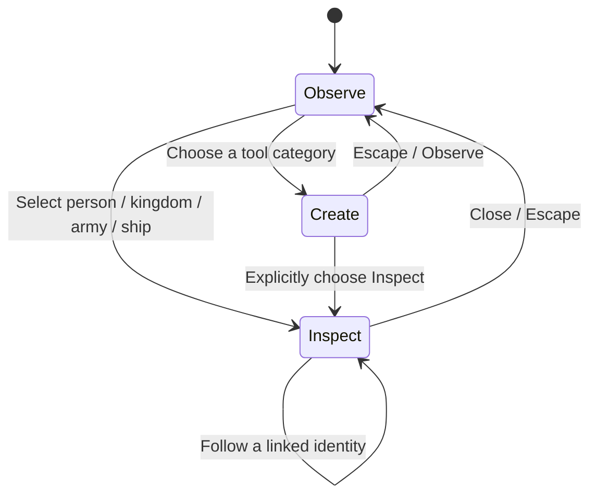

# UI plan: a clear view of a living world

Companion to the [implementation path](README.md). This is a design specification,
covering the full target. Version 0.18.0 introduced the first slice; 0.19.0 adds
map layers, saved-world management and presentation view. Version 0.20.0 adds
compact army inspection and focus/follow. Version 0.21.0 adds saved autonomous
order/reason display. Ship inspectors and local-conquest explanations remain part
of later military and transport work.

## The reference's useful pattern

Normal play leaves most of the screen to the map. Bottom tool groups expose more
choices on demand. Selecting or hovering an entity reveals compact identity and
statistics; detailed windows carry deeper information. Borders, banners, crowns,
settlement silhouettes and troop markers communicate state in the world itself.

This is progressive disclosure: complexity exists, but it is not all permanently
visible. The reference's tiny text and some dense advanced panels are not targets
to copy. Use readable labels, keyboard access and our original artwork.

## Current UI versus proposed UI

The existing `artifacts/world-desktop.png` screenshot and `src/layout.css` show a
large header, a 232-pixel creator sidebar, a 176-pixel catalog, and a separate
bottom time bar. The sidebar can already collapse. Our change is to make a quiet
watching layout the default and reveal editing details only when needed.

| Surface | Proposed behavior |
| --- | --- |
| Canvas | Fill the window behind compact HUD elements; avoid a large decorative frame and unused margins. |
| Header | Small Menu/world identity at the top left; no permanent marketing tagline or row of file actions. |
| Time | Pause/Resume, selected speed, year and age in one consistent strip; accessible in both modes. |
| Bottom dock | Observe, Land, People, Animals, Plants, Events; icon plus short label; a clear selected state. |
| Tool choices | A compact popover above the active category; scroll within it if needed. Only one category open. |
| Brush options | Size and action hint appear with the selected brush; hide them in Observe. |
| View controls | One Layers control for Political, Armies, Routes, Resources; close the menu after choosing. |
| Inspector | One right-side non-modal panel, 280–320 CSS pixels wide; summary and optional tabs. |
| Help | One short contextual hint; the full guide opens on request and can be dismissed. |
| History | A badge opens a filterable view; quiet milestone notifications with optional Visit actions. |
| Save/load | Menu → Worlds; compact save-state indicator and recovery entry. |
| Presentation view | Hide creator tools and noncritical HUD; preserve a way to pause and exit. |

See the [three-state layout concept](ui-layout.svg). Sample names, counts, and events
in that diagram are illustrative, not values extracted from a running save.

## Interaction states

- **Observe:** map clicks select; dragging pans; no terrain or life tool is armed.
- **Create:** the chosen tool, brush footprint and action hint remain visible.
  Ordinary left click/drag applies the tool; right/middle drag or Space-drag pans.
- **Inspect:** clicking selects another entity; Follow is an explicit action.
  Closing the inspector returns to Observe, without restoring a destructive brush.
- **Escape:** close the topmost popover/dialog first; otherwise cancel Create or
  close the inspector. Never resume simulation or select a brush implicitly.
- Keep Space for pause when not typing; choose another modified gesture for pan
  if Space-drag cannot avoid a pause conflict. Resolve this in the M0 prototype.
- UI pointer events never reach the canvas. Switching a category does not place
  a unit. No action should happen on both pointer-down and pointer-up.
- Preserve the existing rule that setup/file dialogs pause the simulation. Closing
  them restores the previous running/paused state. Ordinary inspectors can stay live.
- While following, manual pan stops Follow and leaves the camera at its current
  location. Return to overview and previous view are explicit controls.

## Inspector hierarchy

| Entity | Summary shown first | Optional details |
| --- | --- | --- |
| Citizen | Portrait, name, age, kingdom, health, current action, Follow. | Needs/health; actual stat modifiers; equipment; family/relationships. |
| Kingdom | Flag, name, ruler, population, towns, food, army and current strategy. | Economy; military; diplomacy; culture; history. |
| Town | Name/owner, residents, shelter, food access, buildings, siege if active. | Production/staffing; shortages; local defense; recent ownership. |
| Army | Banner, named home/commander if modeled, size, order, destination, supply. | Members; equipment; route; battle summary. |
| Ship | Owner, crew, mission, passengers/cargo, destination, health. | Passenger identities; route; mission interruption reason. |

Each important condition should answer three questions: **What is happening? Why?
What can I inspect next?** Examples: “Waiting for 4 soldiers at Westhaven dock”,
“Recruitment paused: food reserve low”, and “No reachable landing on this coast”.
These are proposed states; display them only when backed by actual simulation data.

Use one selected outline, one flag/name heading, and a short primary summary.
Family, kingdom, town, ruler, army and ship links should navigate within the same
inspector. Preserve tab position during live updates; avoid rebuilding the entire
panel in a way that loses focus, scroll, or hover tooltips.

## Labels, layers and visual feedback

- At world scale, prioritize kingdom names and capitals; hide citizen names.
- At regional scale, reveal towns and army banners; cluster crowded markers.
- At close scale, show citizens, equipment, jobs, buildings and local effects.
- Always show the selected/followed entity even when other labels are culled.
- Political tint should preserve biome readability; selection uses outline/pattern
  as well as color. Do not depend on red/green alone for war/peace or shortages.
- Armies layer shows forces, targets and active sieges. Routes layer shows actual
  missions/trade, not an unexplained web of decorative lines.
- Make victories, damage, projectiles, fire and repair visible without filling the
  map with permanent numbers or flashing panels. Allow reduced motion/effects.
- Use our own consistent pixel icons. Give unfamiliar icons a hover/focus tooltip
  with name, action, shortcut and relevant cost or effect.
- Add contextual explanations to existing traits and gear before adding more icons.
- Do not expose simulation tick rates, debug budgets or implementation names in
  normal player controls. Keep diagnostics behind an optional developer view.

## Layout and readability acceptance criteria

These are proposed targets, not measurements of the reference or current app.

- At 1366×768, idle Observe leaves ≥80% of the window as unobstructed map area.
  Count the union of visible HUD/panels, excluding hidden menus; exclude no space
  merely because it is transparent. With an inspector open, target ≥55%.
- Use roughly 40-pixel top and 64-pixel bottom HUD allowances in Observe; a Create
  popover can temporarily use more. Avoid adding a second permanent toolbar.
- At 1024×768, every category, pause, speed, zoom, inspector close and Menu remains
  reachable; only popover/panel content scrolls, not the whole application.
- Use ≥13 CSS-pixel primary UI text and ≥36×36 click targets, with larger targets
  where practical. Focus indicators, text scaling and keyboard tooltips remain visible.
- Pause and speed state are always clear; opening an ordinary inspector does not
  silently switch the game between paused and running.
- Selecting, opening a panel and changing a layer do not jump the camera. Follow,
  Visit event, Fit world, and explicit selection focus are intentional exceptions.
- Entity details never paint terrain, spawn life, or alter diplomacy merely by
  opening. Modification actions have explicit labels and current-state feedback.
- Compare screenshots in idle Observe, open tool catalog, citizen/kingdom/ship
  inspection, dense war view, setup and compact window. Exercise real pointer and
  keyboard input as well as DOM checks before claiming the UI is complete.

## First buildable slice

Implement Observe default, the compact dock, contextual brush controls and a short
citizen/kingdom inspector using existing data. Review that in the real desktop app
before changing military behavior. This makes the first update small enough to
evaluate visually and gives later mechanics a consistent place in the interface.
