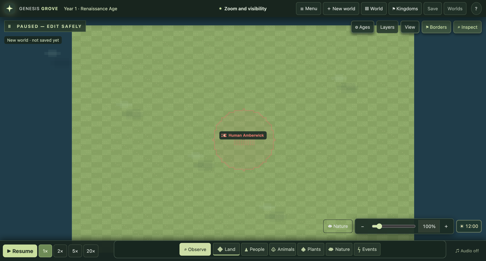
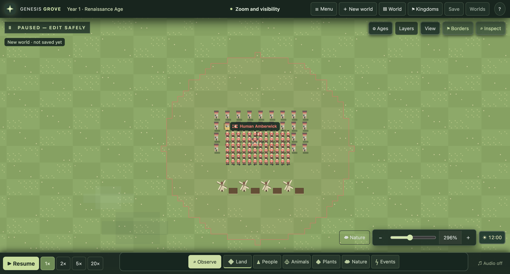
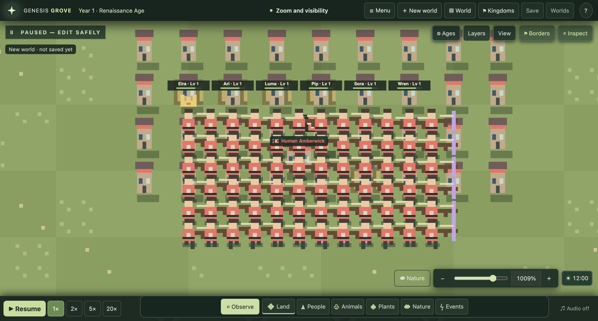

# Zoom and visibility, 0.25.0

The camera now reveals more detail as the player moves closer. Controls and text
keep their screen size. This follows the confirmed visual behavior in the
[phone study](video-analysis/phone-zoom-study.md); the animation timing below is
our implementation choice, not a measured WorldBox timing.

| View | Rendering | What stays available |
| --- | --- | --- |
| World: tiles below 8 CSS pixels | Citizens become small kingdom-colored markers; ordinary houses and facilities are hidden | Geography, capitals, inhabited town labels, army badges, weather and selected life |
| Town: tiles from 8 to below 26 CSS pixels | Houses, facilities and citizen sprites appear | Fixed-size labels and the usual inspectors |
| Citizen: tiles at least 26 CSS pixels | Close artwork is visible; at 42 pixels, bounded names and activity details appear | Up to six citizen cards and 24 activity decorations, plus the selected citizen's activity |

The thresholds use actual tile size rather than an arbitrary percentage, so a
smaller window reveals detail at a comparable visible scale. Selected creatures
keep their sprite and profile at every level. Armies remain selectable. Presentation
changes never alter the saved population, homes, buildings, economy or terrain.

## Camera controls

- Wheel or trackpad zoom follows the cursor. Buttons and keyboard +/− zoom about
  the viewport center. Rapid input accumulates toward a common target scale.
- Wheel and button input use short exponential easing with a 55 ms time constant.
  Fit, direct camera focus and panning interrupt unfinished zoom without a jump.
- The slider and two-finger gestures follow input directly. A pinch scales about
  its midpoint and moves the world with that midpoint. No release inertia is added.
- Reduced-motion preference makes new zoom input immediate. Enabling it during
  an animation completes that zoom around its original anchor.
- Fit restores the whole map. Panning is bounded to keep a portion of the world
  recoverable. Resizing preserves the center world point, subject to this boundary.
- Any manual zoom stops following a creature or army, so Follow cannot pull the
  camera away from the player's chosen zoom position.

The existing 0.65–24 range is retained relative to the fitted map. This release
does not claim that range matches WorldBox's unmeasured limits.

## Touch editing

One finger pans in Observe mode; a tap opens the normal inspector. Two fingers
pan and zoom in either Observe or Create. A touch brush previews its path and
commits on lift. Adding a second finger discards the entire pending stroke. A
cancelled gesture, blur, resize, or tool change also discards that preview.
Mouse brushes continue applying immediately. Help explains both input styles.

## Verification

Camera tests check per-frame anchor accuracy, accumulated input, Fit and pan
interruption, resize, bounds, reduced motion and cancelled/three-finger gestures.
Native Chromium touch tests compare exact paused saves before and after pinch
with a terrain brush active, then check that a deliberate one-finger stroke commits.
World, town and citizen screenshots use one staged saved fixture at 1024×768 and
1366×768. They are not captures of a private user world or WorldBox assets.
